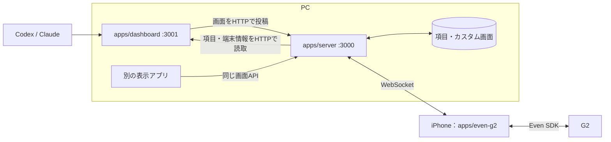

# アーキテクチャ：APIサーバーと表示アプリの分離

2026-09-25に分離。PCではAPIサーバーとダッシュボードが別プロセスで動く。iPhoneの汎用Pluginはそのまま使う。



## 役割と依存

| プログラム        | 担当                                                                  | 持たないもの                                     |
| ----------------- | --------------------------------------------------------------------- | ------------------------------------------------ |
| apps/server       | HTTP/WS、認証、画面検証・配信、端末状態・操作・センサー中継、項目保存 | 時計、Codex/Claude監視、アイコン、画面レイアウト |
| apps/dashboard    | 監視、時計、バッテリー表示、下部AI行、ページ構成、画面生成            | G2のSDK呼出、Bluetooth接続、DBへの直接アクセス   |
| apps/even-g2      | PCからの画面をSDKで描画、アニメーション、操作・センサー返送           | 表示内容の選定やエージェント監視                 |
| packages/protocol | 共有する型と入力検証                                                  | 実行プロセス・監視・通信実装                     |

両PCアプリの実行コードは互いをimportしない。ダッシュボードはAPI経由だけで通信する。統合テストでは両方を起動する。既存のnow/soon/waiting項目APIは互換性のためAPIサーバーに残すが、項目から画面を作る処理はダッシュボードにある。

## 画面の優先順位

1. `/api/screen` に保存したカスタム画面。解除するまで最優先。
2. `/api/display/live` に表示アプリが投稿した有効な画面。
3. 表示アプリの期限切れなら、最後の画面のofflineContent / offlineScene。
4. まだ一度も投稿されていなければ `Waiting for display app`。

`GET /api/screen` とAPIサーバーのhealth.screenModeはcustom / live / offline / idleを返す。旧agents / itemsモード名は廃止。`pnpm screen reset` はカスタム画面だけを解除し、動作中の表示アプリへ戻す。

ダッシュボードは1秒ごとに項目と端末情報を読み、監視は別の3秒周期で行う。表示内容の変化時、または5秒ごとに画面を投稿する。リースは20秒で、表示アプリ停止・ハング・通信断では期限切れ後にOFFLINE表示へ切り替わる。APIのWebSocketが接続中でも古い「実行中」をそのまま表示し続けない。時計はOFFLINEになった時点の画面のままで進めない。

## 汎用ライブ画面API

APIサーバーの `http://127.0.0.1:3000` に対して呼ぶ。書込にはAPI_TOKEN設定時Bearer認証が必要。

| メソッド | パス              | 内容                                             |
| -------- | ----------------- | ------------------------------------------------ |
| PUT      | /api/display/live | 画面全体を投稿し、送信者のリースを更新           |
| GET      | /api/display/live | online / publisherId / expiresAt                 |
| DELETE   | /api/display/live | 本文のpublisherIdのリースを解放。画面はOFFLINEへ |

PUT本文例:

```json
{
  "publisherId": "994dc43c-2b5f-4c0e-8639-2de801de09bd",
  "ttlSeconds": 20,
  "display": {
    "version": 1,
    "updatedAt": 0,
    "generatedAt": 0,
    "pages": [
      {
        "id": "main",
        "content": "Hello",
        "offlineContent": "Display app offline"
      }
    ]
  }
}
```

publisherIdはアプリ起動ごとに生成するUUID。投稿中は同じIDを使う。ttlSecondsは5〜120秒、省略時20秒。displayは既存の画面プロトコルversion 1で、1〜16ページ。scene / offlineSceneを指定すれば自由配置・画像も利用できる。本文上限4MiB。描画制約は[画面API](screen-api.md)を参照。

有効なリースは同時に1つ。別IDからの投稿や他人のリース解放は409。同じIDの投稿は更新し、期限切れなら別IDが取得できる。200はAPIの受付であり、G2の描画成功ACKではない。IDは認証資格情報ではなく、信頼済み書込元どうしの競合を防ぐための識別子。セキュリティ境界はBearer認証とネットワーク到達制御。

ライブ画面はメモリーのみでDBへ保存しない。APIサーバー再起動後は表示アプリが再投稿する。ダッシュボードを強制終了して再起動したときは新IDになるので、古いリースが切れるまで最大20秒待つ。正常終了では自分のリースを解放する。

## 実行と障害時

- `pnpm start`: 監督プロセスがAPIサーバーとダッシュボードを起動。両方のログを.localへ保存。
- `pnpm start:server`: APIだけを前景起動。
- `pnpm start:dashboard`: 表示アプリだけを前景起動。
- `pnpm dashboard:restart`: 常駐構成の表示アプリだけ再起動。API・G2接続は維持。
- `pnpm api:restart`: 常駐構成のAPIだけ再起動。Pluginは再接続、表示アプリは再投稿。

監督プロセスはそれぞれの子の終了から3秒後に再起動する。表示アプリを意図的に停止したままにしたい場合は常駐全体を止め、APIだけを起動する。詳しくは[運用手順](server-operations.md)。

| 確認先            | 内容                                                   |
| ----------------- | ------------------------------------------------------ |
| :3000/health      | API・G2接続数・画面モード・送信者リース                |
| :3001/health      | 表示アプリ・APIへの最終投稿・監視状態。投稿不可なら503 |
| :3001/api/agents  | 旧:3000/api/agentsから移動した監視結果                 |
| :3001/api/display | 表示アプリが生成した最新画面。カスタム画面優先とは独立 |

3001番は127.0.0.1限定。Tailscale Serveは従来どおり3000番のみ。表示アプリの送信先はDASHBOARD_SERVER_URL、未指定ならlocalhostのPORT。状態確認のポートはDASHBOARD_PORT、既定3001。

## 今後の追加機能

通知や予定など、何を中央へ出すかは `apps/dashboard` 側へ追加する。別の表示アプリを作る場合は同じライブ画面APIを使える。現時点のAPIは全画面単位で、中央領域だけの書込や複数アプリの画面合成は未実装。領域の分割・優先順位は表示アプリ側の責務とする。
